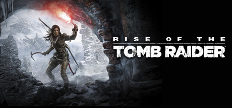

**Rise of the Tomb Raider is the acclaimed sequel in the rebooted Lara Croft saga, set in a stunning Siberian wilderness. Features expanded tombs, expanded crafting, and a deeper story about Lara's obsession with her father's legacy and a secret immortal organization.**

---

## 📖 About

Rise of the Tomb Raider is the acclaimed sequel in the rebooted Lara Croft saga, set in a stunning Siberian wilderness. Features expanded tombs, expanded crafting, and a deeper story about Lara's obsession with her father's legacy and a secret immortal organization.

## ⚠️ Problems Without Trainer

| Problem | Status |
|---------|--------|
| **Challenge Tomb Volume** — Optional tombs require backtracking with specific gear upgrades | ✅ Solved |
| **XP Grind** — Unlocking all skills requires completing many optional challenges | ✅ Solved |
| **Stealth vs Combat Balance** — Late-game sections force combat on players preferring stealth | ✅ Solved |
| **Collectible Density** — 200+ relics and documents require exhaustive area searching | ✅ Solved |

## ✅ Solution

The **Rise of the Tomb Raider Trainer** solves all these issues by giving you complete control over the game.

## 🎯 Full Feature List

- Unlimited Resources
- God Mode / Invincibility
- Instant Skill Cooldown
- One-Hit Kill
- Freeze Game Timer
- Unlock All Items & Achievements
- Custom Speed Multiplier
- Save State Anywhere

## 🚀 Quick Start

1. **Disable Windows Defender** temporarily (trainer may trigger false positive)
2. Download the trainer from the button above
3. Launch Rise of the Tomb Raider
4. Run the trainer as Administrator
5. Activate desired cheats with hotkeys

## 💎 Free vs Paid

| Feature | Free | Pro |
|---------|------|-----|
| Basic God Mode | ✅ | ✅ |
| Unlimited Resources | ✅ | ✅ |
| All Advanced Cheats | ❌ | ✅ |
| Auto-Updates | ❌ | ✅ |
| Priority Support | ❌ | ✅ |

## 💻 Requirements

- Windows 10/11 (64-bit)
- Rise of the Tomb Raider (any version)
- .NET Framework 4.8+
- DirectX 11+

## 🍎 macOS

macOS users can use our alternative tool:

## ⚖️ Legal

This trainer is for educational and single-player use only. Use responsibly.

---

